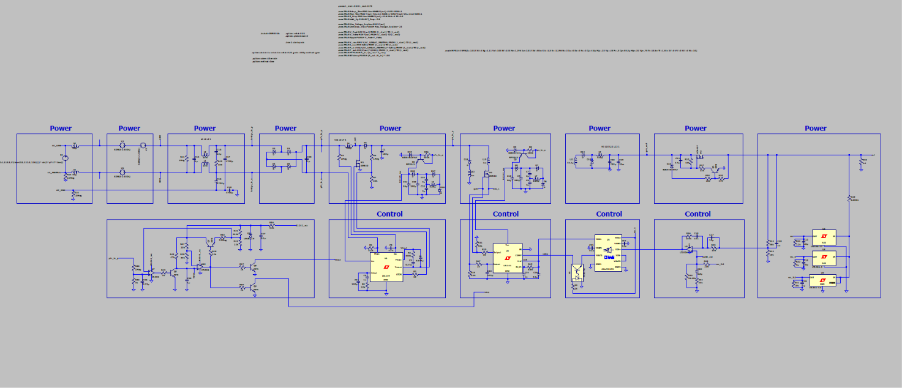

# Isolated 24 V / 240 W AC-DC Power Supply with Active PFC (LTspice)

A two-stage offline AC-DC power supply designed and simulated in LTspice, targeting the Mean Well SDR-240-24 specification (24 V, 10 A, 240 W, active PFC).

## Specifications

| Parameter | Target | Simulated result |
|---|---|---|
| Output voltage | 24 V | 24 V |
| Output current | 10 A | 10 A |
| Output power | 240 W | 240 W |
| Power factor | Active PFC | 0.997 |
| Efficiency | - | about 90% |
| Output ripple | - | about 21 mV |
| Low-line input | - | about 89 Vrms |

## Architecture

1. **Boost PFC stage** built around the LT1249 controller.
2. **Isolated forward converter** built around the LT1241 controller, using an IRF840 power MOSFET (`IRF840.lib`).
3. **Isolated feedback loop:** LT1006 error amplifier, ADuM3195 isolated feedback block, and PC817 optocoupler.
4. **EMI input filter:** common-mode choke and X/Y capacitors, tested against injected 200 kHz and 300 kHz noise.

## Files

| File | Description |
|---|---|
| `Draft2.asc` | LTspice schematic (open this file) |
| `IRF840.lib` | SPICE model of the IRF840 MOSFET used in the design |
| `circuit_image.png` | Image of the schematic |

## How to run

1. Install [LTspice](https://www.analog.com/en/resources/design-tools-and-calculators/ltspice-simulator.html).
2. Download or clone this repository and keep `Draft2.asc` and `IRF840.lib` in the **same folder**, so LTspice can find the model.
3. Open `Draft2.asc` in LTspice.
4. Run the transient simulation.
5. Open **View > SPICE Output Log** to see the results printed by the `.meas` directives.

The transient analysis is automated with `.meas` directives under a stepped low-line input (about 89 Vrms).

## Design notes

- **Designed by me:** <!-- list the parts you sized yourself, e.g. boost inductor, transformer turns ratio, output filter, compensation network, EMI filter values -->
- **Based on manufacturer reference circuits:** <!-- list the sub-blocks adapted from datasheet/reference circuits, e.g. controller application circuits -->

## Results

<!-- Optional but recommended: add screenshots of the waveforms, e.g.

-->

## Tools

LTspice, with IRF840 MOSFET SPICE model.

## Author

Amr Ashraf Gadalla
[LinkedIn](https://linkedin.com/in/amr-ashraf-86457134a) | [GitHub](https://github.com/TendoPain18) | [Portfolio](https://amr-portfolio.streamlit.app/)
